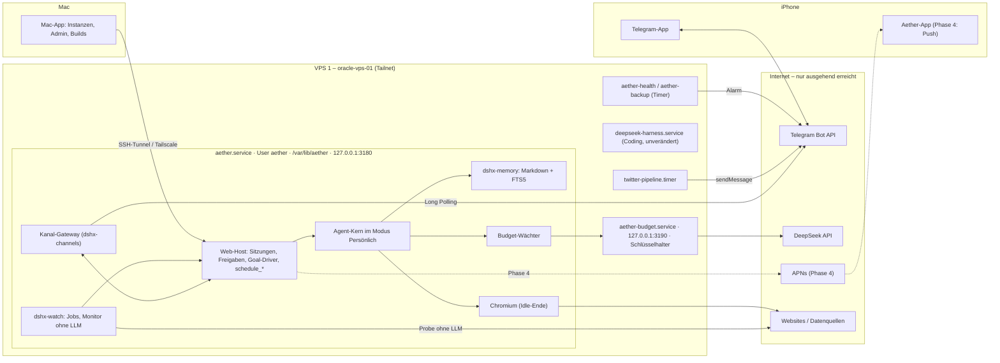

# Aether als Personal Agent: Infrastruktur- und Umsetzungsplan

Stand 28.10.2026 (Europe/Berlin), Branch `codex-app` @ `ce6da58` plus die nicht committeten Anbieteränderungen im Arbeitsbaum (Mac-App Build 101). Dies ist ein Plan. Nichts davon ist umgesetzt, auf keinem VPS wurde etwas geändert.

**Grundlagen**

- **Analysen:** [hermes-agent.md](hermes-agent.md) (Commit `780d5a3`, v0.22.5) und [openclaw.md](openclaw.md) (Commit `4757ac8`, v2026.10.8). Verweise wie „Hermes §6 H2“ oder „OpenClaw §4.4“ zeigen auf deren Abschnitte.
- **Unser Code:** alle Crates unter `crates/`, die Verträge [docs/rust/SPEC.md](../../rust/SPEC.md) und [docs/aether/SPEC.md](../SPEC.md), dazu README, CHANGELOG, [docs/ux-plan.md](../../ux-plan.md), [docs/providers.md](../../providers.md), `ios/`, `brand/` und der Hub-Branch `worktree-agent-a28ffddbc7d938f9c` (`064ff68`).
- **Infrastruktur:** `OracleVPS/Agents.md`, `state.md`, die letzten Einträge in `log.md` und die Betriebskopien unter `OracleVPS/services/`.

**Methode**

- Nur gelesen: kein SSH, kein Build, keine Tests, keine zustandsändernden Git-Operationen, keine Geheimnisse.
- Aussagen über unseren Code sind mit Datei und, wo sinnvoll, Zeile belegt und selbst mit `grep`/`sed` geprüft.
- Messwerte stammen aus `state.md`, `log.md` und den Snapshots. Wo Live-Werte fehlen, ist ein Messschritt eingeplant (Phase 0).
- **Annahme** markiert Ableitungen, die sich nicht belegen lassen.

---

## Kurzfassung

| Frage | Empfehlung |
|---|---|
| Wo lebt der Agent? | **VPS 1, als eigene zweite Instanz** `aether.service`: eigener Linux-Benutzer `aether`, eigenes `DSHX_HOME=/var/lib/aether`, Loopback-Port 3180. Die bestehende Coding-Instanz `deepseek-harness` bleibt unverändert. VPS 2 bleibt ein getrennter Arbeitsbereich. |
| Welcher Prozess? | Dasselbe Binary im Modus `dsh-codex web`, erweitert um Kanal-Gateway, Gedächtnis und Jobs. Kein eigener Daemon, weil Sitzungssperren, Goal-Driver, Zeitplan-Zustellung und Freigaben schon im Web-Host leben. |
| Erster Kanal | **Telegram** per Long Polling: nur ausgehende Verbindungen, kein neuer Port, Buttons für Freigaben, Medien. Danach die Aether-App mit Push, dann E-Mail. iMessage nur über den Mac. |
| Prompt-Konflikt | **Eigener Modus „Persönlich“** (`Preset::Personal`). Standard und Minimal bleiben byte-identisch zu DSH. Der Personal-Prompt ist je Binary-Version konstant. Gedächtnis und Kanalhinweise kommen als eingefrorener Block am Sitzungsanfang, Änderungen als Notiz im User-Kanal. |
| Schutz | Eigene Instanz und eigener Benutzer, Schlüssel außerhalb der Reichweite der Tools, Tool-Policy je Sitzungsart, gekennzeichnete Fremdinhalte, nur der Owner spricht mit Aether, harte Ausgabengrenze außerhalb des Agentenprozesses. |
| Was zuerst? | Phase 0 (Arbeitsbaum ordnen, messen, entscheiden). Dann **MVP „Aether auf Telegram“** mit kleinem Gedächtnis, Freigaben per Button, Budget und Erinnerungen über die vorhandenen `schedule_*`-Tools. Danach Suche im Gedächtnis, Beobachtungen ohne LLM-Kosten, mehrtägige Ziele. |
| Kosten | Geschätzt **3–8 USD/Monat** für DeepSeek bei funktionierendem Cache, ohne Cache etwa das Vierfache. Oracle bleibt im Free Tier. |

---

## 1. Zielbild und Leitprinzipien

### 1.1 Was „Personal Agent“ für diesen Nutzer heißt

Abgeleitet aus `state.md` (Oxygen, Z. 381–430; Twitter-Pipeline, Z. 431–480) und dem, was auf den Maschinen liegt:

| # | Fähigkeit | Quelle |
|---|---|---|
| Z1 | **Websites und Daten beobachten**, bei Bedarf handeln. | Oxygen-Wunsch vom 16.10. (`state.md` Z. 383, 414) |
| Z2 | **Ein Ziel über mehrere Tage verfolgen**, auch über Neustarts hinweg. | ebd.; heute starten Goals nach einem Neustart deaktiviert (Z. 400) |
| Z3 | **Ergebnisse aufs Handy**, ohne dass ein Rechner offen ist. | Telegram war für die Twitter-Pipeline schon vorgesehen (Z. 433, 474) |
| Z4 | **Vom Handy aus beauftragen und freigeben.** | Annahme. Die iOS-App ist dafür begonnen (`docs/aether/SPEC.md` §4). |
| Z5 | **Den Nutzer kennen**: Sprache Deutsch, Zeitzone Berlin, Arbeitsfelder, Vorlieben. | Annahme aus den Daten auf VPS 1 (new-marketing, Hormozi, Twitter-Entwürfe) und den Skills des Nutzers (SEO, SISTRIX, Mail) |
| Z6 | **Im Free Tier bleiben.** Kostenpflichtiges entscheidet der Nutzer. | `Agents.md` „Ressourcen und Kosten“ |

Seit dem 16.10. offen sind Beobachtungsgegenstand, Intervall, Ergebnisweg und Budget (`state.md` Z. 414). Dieser Plan legt den Ergebnisweg (Telegram) und die Budgetmechanik fest. Gegenstand und Intervall bleiben Nutzerentscheidung E5.

**Annahme zu ersten Aufträgen** (Vorschlag für E5):

1. **Morgenbriefing um 06:30:** neue Twitter-Entwürfe, Ergebnisse der Beobachtungen, offene Ziele, Kosten des Vortags.
2. **Zwei bis drei Beobachtungen**, etwa Inhalte einer Kundenseite, ein Preis oder ein Datensatz.
3. **Rückfragen und kurze Recherchen** per Telegram.

### 1.2 Was Aether ausdrücklich nicht tut

- **Keine Außenwirkung ohne Freigabe:** Er postet nichts, sendet keine Mails, kauft nichts und legt keine Konten an. Außenwirkung entsteht nur mit Freigabe des Nutzers und nur in Formen, die eine Phase ausdrücklich einführt.
- **Nichts aus dem Arbeitsbereich von VPS 2:** Diese Aufgaben laufen dort, getrennt vom Personal Agent.
- **Nur der Owner:** Aether spricht nur mit seinem Owner. Gruppen und Dritte sind im MVP nicht vorgesehen.

### 1.3 Leitprinzipien

1. **Wenig, aber sauber.** Ein Kanal, ein Gedächtnis, ein Jobsystem. Die Breite von Hermes und OpenClaw ist ausdrücklich kein Ziel (Hermes §6 „Bewusst nicht übernehmen“ 1, OpenClaw §7.10).
2. **Kosten durch Struktur:**
   - stabiler Prompt-Präfix
   - Beobachtungen ohne LLM-Aufruf, solange die Quelle unverändert ist
   - feste Denkstufe je Sitzung
   - Hintergrundarbeit außerhalb der DeepSeek-Spitzenzeit
3. **Schutz durch Trennung statt durch Musterlisten:** eigene Instanz, eigener Benutzer, Schlüssel außerhalb der Reichweite der Tools, harte Grenzen außerhalb des Agentenprozesses (Hermes §4.8).
4. **DSH-Kompatibilität bleibt, wo sie versprochen ist.** Standard und Minimal ändern sich nicht. Der neue Modus ist bewusst anders und eigens getestet.
5. **Nachvollziehbar:**
   - Gedächtnis als lesbares Markdown mit Git-Historie
   - Sitzungen als v4-Event-Log
   - ein Audit-Protokoll für Kanal und Freigaben
6. **Messen statt annehmen:** RAM, Cache-Trefferquote und Build-Zeiten vor und nach jedem Schritt messen und nach `Agents.md` dokumentieren.

---

## 2. Ist-Stand: dsh-codex gegen den Bedarf

### 2.1 Fähigkeitsmatrix

✅ vorhanden · 🟡 teilweise · ❌ fehlt

| Bedarf | Stand | Beleg im Code | Bemerkung |
|---|---|---|---|
| Agent-Loop mit Tools, Retries, Abbruch, Steering | ✅ | `crates/dshx-agent/src/agent.rs` (`run_turn` Z. 329, `followup` Z. 343, `steer_message` Z. 404), `scheduler.rs`, `retry.rs` | DSH-identisch; `PromptRequest.steer` in `dshx-server/src/lib.rs` Z. 104 ff. |
| Persistente Sitzungen | ✅ | `crates/dshx-session` (v4, zstd); `lock.rs`: exklusiver `flock` auf `session.lock` | Eine Sitzung gehört genau einem Prozess. |
| Komprimierung | ✅ | `dshx-agent/src/compaction.rs`; `dshx-core/src/config.rs` `CompactionSettings` (Standard 200.000) | zwischen Runden; DSH-Notbremse bleibt |
| Identität/Persona | 🟡 | `dshx-agent/src/config.rs` `PromptConfig` Z. 135 (`persona_prefix`, `persona_suffix`, `extra_sections`, `extra_context`); `Preset` Z. 88 | Mechanik da, keine Personal-Persona |
| Erweiterungspunkt je Schritt | ✅ | `dshx-agent/src/hooks.rs` `PreStepHook` Z. 89 | So kommen Skill-Katalog und Uhrzeit cachefreundlich als User-Nachricht in den Kontext. |
| Workspace-Anweisungen | ✅ | `dshx-agent/src/instructions.rs` (AGENTS.md-Kette inkl. user-global) | `<system-reminder>`-Baseline am Sitzungsanfang |
| Sitzungsübergreifendes Gedächtnis | ❌ | `dshx-session/src/memory.rs` ist nur ein In-Memory-`SessionLog` für Tests; keine SQLite im Workspace (`Cargo.toml`) | größte inhaltliche Lücke |
| Zeitpläne | 🟡 | `crates/dshx-schedule`: `record.rs` Z. 46 (`id, title, prompt, rule, scheduled_at`); `service.rs` stellt als Follow-up in die Ursprungssitzung zu | DSH-kompatibel, nur `dsh-codex web` stellt zu. Kein Kanalziel, kein Monitor-Modus, kein Modell-Pin, kein Schweigen. |
| Goals über Tage | 🟡 | `dshx-goal/src/service.rs` Z. 2–3, 293: Aktivierung prozesslokal, Start im Zustand `disarmed` | Rundenlimit (Code-Standard 256, auf VPS 1 per `config.toml` 20). Keine USD- oder Zeitgrenze, kein Wiederanlauf. |
| Subagents, Teams | ✅ | `dshx-subagent/src/runtime.rs` Z. 52–61 (Tiefe 1, 8 aktive Kinder); `dshx-team` | Kinder ohne `schedule_*` (`dsh-codex/src/automation.rs` Z. 110) |
| MCP inkl. OAuth, auf Abruf | ✅ | `dshx-mcp/src/lib.rs`; `dsh-codex/src/runtime/ondemand.rs` (`@server` per `tool_addition`) | Grundlage für spätere Integrationen |
| Skills, Plugins | ✅ | `dshx-tools/src/skill`, `dshx-plugins` | Standard `catalog = "manual"` |
| Browser | ✅ | `dshx-browser/src/browser.rs` (eigenes Profil, Pipe, Idle-Ende Z. 1028) | VPS 1: `idleMinutes = 15` (`services/vps-01-rust-config.toml`) |
| `web_fetch` | ✅ | `dshx-tools/src/web.rs` (nur öffentliche Adressen, Redirects nur same-origin) | |
| Websuche | ❌ | `dshx-tools/src/web.rs` Z. 738: `WebSearchTool` meldet „not configured“; `dsh-codex/src/runtime.rs` Z. 347 bietet es nicht an | Schema ist DSH-identisch vorhanden. |
| Messenger-Kanäle | ❌ | `dsh-codex/src/main.rs`: nur `web`, `sdk`, `login`, `logout` | |
| Push | ❌ | Browser-Benachrichtigungen und Dock-Badge (CHANGELOG); in `ios/` kein `UNUserNotificationCenter` und kein APNs | |
| Server-API und Auth | ✅ | `dshx-server/src/lib.rs` Z. 407 `require_token`, Z. 436 `host_is_loopback` | Start-Token wechselt bei jedem Neustart. Mobile-Listener und Client-Tokens aus Aether-SPEC §3 fehlen (kein `/api/mobile` im Code). |
| Freigaben | 🟡 | `dshx-tools/src/sandbox.rs` Z. 90 ff., `dshx-agent/src/scheduler.rs` Z. 640 ff., `dsh-codex/src/web.rs` Z. 973/1001 | Nur für Sandbox-Eskalation. Kein Zeitlimit, Policy nur `ask`/`never`. |
| Tool-Policy je Sitzungsart | ❌ | nur Presets und Sandbox-Modi | |
| Pfadausblendung für Tools | ❌ | `dshx-tools/src/sandbox.rs` Z. 169 (Profil ohne ausgeblendete Pfade); `fs/mod.rs` Z. 232 (Pfadregeln nur für Schreibzugriffe); `env.rs` filtert Umgebungsvariablen | Geplant in Phase 1 (§7) |
| Kennzeichnung fremder Inhalte | 🟡 | `dshx-agent/src/prompt.rs` (DSH-Satz „external, untrusted data“ bei `web_fetch`/`web_search`) | nur ein Prompt-Hinweis, keine Abgrenzung im Ergebnis |
| Kosten erfassen | ✅ | `dsh-codex/src/usage.rs` (Preisbuch Z. 58–75, Spitzen-/Nebenzeit Z. 314) | |
| Kosten begrenzen | ❌ | keine Durchsetzung in `usage.rs` oder `dshx-agent` | |
| Modell-Routing | 🟡 | `dshx-llm` `ProviderRouter`; `title_model` je Anbieter (`dshx-core/src/config.rs` Z. 200) | kein Modell-Pin je Job oder Sitzungsart |
| Uhrzeit im Kontext | ✅ | `dshx-schedule/src/time_context.rs` (letzte Nachricht, höchstens alle 10 min) | cachefreundlich |
| Accounts-Hub und Relay | 🟡 | Branch `064ff68`, `crates/dshx-hub` | Nicht gemergt, nicht deployt, soll offline bleiben. |
| iOS-App | 🟡 | `ios/` (nicht committet): Transports https/http/ssh/hub | ohne Push |
| Sprache (STT/TTS) | ❌ | README: „Not ported: … voice“ | |

### 2.2 Befunde, die den Plan prägen

- **B1 – Schlüssel und Tools teilen einen Benutzerkontext.** Konfiguration und `credentials.toml` gehören demselben Dienstbenutzer, unter dem auch die Tools laufen. Eine Ausblendung dieser Pfade fehlt (Matrix oben). Bevor ein Kanal-Token dazukommt, braucht die neue Instanz deshalb Pfadausblendung und einen vorgelagerten Schlüsselhalter (§7, WP 1.4/1.5).
- **B2 – Freigaben warten unbegrenzt** und gelten nur für die Sandbox-Eskalation. Für Freigaben vom Handy fehlen Zeitlimit, Bindung an den Owner und weitere freigabepflichtige Aktionen.
- **B3 – Goals werden nach einem Neustart nicht fortgesetzt.** Das ist DSH-Verhalten (`goal/change` v1, prozesslokales `armed`). Das Format bleibt; die Wiederaufnahme kommt als Richtlinie außerhalb des Goal-Formats.
- **B4 – Zeitpläne sind DSH-Format** (`storages/schedule.json`, Tool-Schemas byte-identisch). Monitor-Modus oder Kanalziel gehören daher in ein eigenes Jobsystem, nicht in `dshx-schedule`.
- **B5 – Eine Sitzung, ein Prozess** (`lock.rs`). Ein separater Gateway-Daemon könnte die Sitzungen nicht selbst fahren. Das Gateway gehört in den Web-Host.
- **B6 – DeepSeeks Cache hängt an der Denkstufe.** Belegt in `log.md`, 25.10., Fix `ce6da58`: 384 statt 18.816 gecachte Tokens bei abweichender Stufe. Jede Sitzung und jeder Job bekommt deshalb eine feste Denkstufe.
- **B7 – Arbeitsbaum und Branches sind ungeordnet:**
  - 17 geänderte Dateien (Anbieter, 446 Zeilen)
  - unversionierte `brand/`, `ios/` und `docs/aether/`
  - der Hub-Branch ist ungemergt
  - `origin/codex-app` steht auf `6e06d32`
  - mehrere alte Worktree-Branches

  Das wird vor neuer Arbeit geordnet (Phase 0.1).

---

## 3. Lehren aus Hermes und OpenClaw

### 3.1 Übernehmen

| Muster | Quelle | Rust-Form bei uns | Phase |
|---|---|---|---|
| Cache-Disziplin: Prompt je Sitzung eingefroren, Änderungen als Notiz im User-Kanal, Prompt-Surface-Snapshot im Test | Hermes §4.1, §6 H1; OpenClaw §6 H2 | `Preset::Personal` mit konstantem System-Prompt; `PersonalContextHook` (ein `PreStepHook`) für den eingefrorenen Block; Golden-Test `tests/golden/personal/` | 1 |
| Kleines, begrenztes Nutzerbild: `USER.md`/`MEMORY.md` mit Zeichenbudget; Batch `add/patch/remove`, kein `replace`; Prüfung beim Schreiben und Laden | Hermes §4.2, §6 H2 | Crate `dshx-memory` (`store.rs`, `scan.rs`, `tool.rs`), Tool `memory` | 1 |
| Identitätsdateien mit Filter je Sitzungsart | OpenClaw §4.2, §6 H1 | `SOUL.md`, `USER.md`, `MEMORY.md`; Filter in `personal/context.rs` (Tabelle §4.5) | 1 |
| Kanal-Trait, Default-Deny, Pairing-Code, Session-Key-Grammatik | Hermes §4.4, §6 H4; OpenClaw §4.6, §6 H4 | Crate `dshx-channels` (Trait `Channel`, `auth.rs`), Schlüssel `personal:telegram:dm:<chat>` | 1 |
| Telegram per Long Polling | Hermes §6 H4; OpenClaw §4.6 | schlanker Client auf `reqwest` (schon im Workspace), kein großes Bot-Framework | 1 |
| Steering mit Entprellung | OpenClaw §4.1, §6 H6 | vorhandenes `steer` plus 1,5 s Debounce für Nachrichtenhäppchen | 1 |
| Turn bei Absturz als „unbekannt“ markieren, nicht wiederholen | Hermes §4.4 | Gateway meldet die unterbrochene Aufgabe, startet sie nicht neu | 1 |
| `NO_REPLY` unterdrückt die Zustellung | OpenClaw §4.5; Hermes §4.5 (`[SILENT]`) | exakte Endantwort `NO_REPLY` wird protokolliert, nicht zugestellt | 1 |
| Fremdinhalte kennzeichnen, Owner-Konzept in der Tool-Policy | Hermes §6 H7; OpenClaw §6 H7 | Tool-Decorator nach dem Muster des vorhandenen `Watched` in `runtime.rs`; `personal/policy.rs` | 1 |
| Sitzungssuche über das Event-Log mit SQLite FTS5, ohne LLM | Hermes §4.2, §6 H3 | `dshx-memory/index.rs` mit `rusqlite` bundled; FTS5 ist im Build aktiv (`libsqlite3-sys-0.39.1/build.rs` Z. 177) | 2 |
| Markdown als Wahrheit, Index abgeleitet, Tagesnotizen | OpenClaw §4.4, §6 H3 | `personal/memory/JJJJ-MM-TT.md`; Index jederzeit neu aufbaubar | 2 |
| Monitor-Modus, Notepad, Kontinuität, Fortschreiben vor dem Start, Watchdog | Hermes §4.5, §6 H5; OpenClaw §4.5 | Monitor-Modus hasht die Quelle und ruft ohne Änderung kein LLM auf. Umsetzung im Crate `dshx-watch`. | 2 |
| Proaktivität nur im Leerlauf, keine alten Aufgaben wiederholen | OpenClaw §4.5, §6 H5 | `idle_only` und der Prompt-Satz aus OpenClaw | 2 |
| Hilfsmodelle für Nebenaufgaben | Hermes §6 M3; OpenClaw §4.10 | Modell und Denkstufe je Sitzungsart in `[codex.personal.models]` | 1–2 |
| Deny-Liste für Subagents | OpenClaw §6 M5 | Kinder ohne Gedächtnis-Schreiben, Jobs und Kanalversand | 1 |
| Websuche-Abstraktion mit festem Extraktionsbudget | Hermes §6 H8; OpenClaw §6 M1 | `SearchProvider`-Trait hinter dem vorhandenen DSH-Schema von `web_search` | 2 |

### 3.2 Angepasst übernommen

- **Learning Loop** (Hermes §4.2, §6 H6): Hermes startet einen Review-Fork, sobald ein Zähler greift (standardmäßig nach zehn User-Turns). Wir ersetzen das durch **eine nächtliche Destillation** mit gestagten Vorschlägen, die der Nutzer per Button übernimmt. Auf einem Kern ist ein Lauf pro Tag planbar, ein Review pro Chatereignis nicht.
- **Pre-Compaction-Flush** (OpenClaw §4.3) ohne zusätzlichen Modellaufruf: Unsere Komprimierung erzeugt ohnehin eine strukturierte Zusammenfassung (`compaction.rs`, Event `compaction/summary`). Sie wird an die Tagesnotiz angehängt.
- **Dreaming** (OpenClaw §4.4) nur als Vorschlag mit Diff und Freigabe, nie unbeaufsichtigt in `MEMORY.md` (OpenClaw §7.8).
- **Freigaben in Schichten** (Hermes §6 M4): harte Blockliste und „im Hintergrund wird nichts freigegeben“ ja, ein LLM als Prüfinstanz nein.
- **Tägliche Sitzungsgrenze** (OpenClaw §6 M6; Hermes „Bewusst nicht übernehmen“ 5): Um 06:00 beginnt eine neue Telegram-Sitzung mit „Startup Context“ aus zwei Tagesnotizen, damit neues Gedächtnis wirkt.

### 3.3 Bewusst nicht übernommen

| Nicht übernehmen | Quelle | Grund für uns |
|---|---|---|
| Funktionsbreite (27–28 Kanäle, 37–62 Anbieter, Nodes, Canvas) | Hermes §5, „Bewusst nicht übernehmen“ 1; OpenClaw §7.10 | ein Kern und 6 GB; Wartbarkeit vor Breite |
| Plugins im Prozess mit vollen Rechten | Hermes „Bewusst nicht übernehmen“ 2; OpenClaw §7.1 | Wir laden nur Skills und MCP, dabei bleibt es. |
| Unbegrenzte Iterationen | Hermes §4.1, „Bewusst nicht übernehmen“ 3 | Rundenlimit plus USD- und Zeitgrenzen |
| Selbstschreibende Skills als Standard | Hermes §6 H6; OpenClaw §4.8 (Skill Workshop) | Hortungsrisiko; Skills schreibt der Nutzer |
| Externe Embeddings als Standard | OpenClaw §7.6 | Datenschutz und Kosten; FTS reicht zuerst |
| Steuern durch andere Teilnehmer | OpenClaw §7.3 | Nur der Owner spricht mit Aether. |
| Leistungsorientierte Defaults ohne Gegengewicht | OpenClaw §7.2 | Personal-Instanz mit `workspace-write`, ohne Eskalation |
| Musterlisten als Sicherheitsversprechen | Hermes „Bewusst nicht übernehmen“ 6 | nur Unfallschutz; die Grenze ist Trennung |
| Abo-Anmeldungen über Fremd-Harnesses, gehostete Anbieter-Gateways | OpenClaw §7.5; Hermes „Bewusst nicht übernehmen“ 7 | rechtlich und betrieblich instabil |
| `browser_exec`, Code Mode | Hermes „Bewusst nicht übernehmen“ 8; OpenClaw §6 N5 | Unsere CDP-Tools genügen. |
| Offene Skill-Registry ohne Signaturen | OpenClaw §7.4 | keine Fremdinstallation in der Personal-Instanz ohne Prüfung |

---

## 4. Zielarchitektur

### 4.1 Überblick



VPS 2 kommt im Bild nicht vor. Er bleibt ein getrennter Arbeitsbereich für andere, autorisierte Aufgaben, ohne Verbindung zu dieser Architektur.

### 4.2 Prozessmodell

**Empfehlung: Gateway, Gedächtnis und Jobs laufen im Prozess `dsh-codex web` der Aether-Instanz.**

- **Der Web-Host hat schon, was ein Kanal braucht:**
  - Agenten und Sitzungssperren (B5)
  - Goal-Driver und Zeitplan-Zustellung, beide nur im Web-Host (`SPEC.md` §5.9)
  - Freigaben (`web.rs` Z. 973)
  - den Ereignisbus `broadcast::Sender<StreamMessage>` mit `Status`, `Approval` und `Event` (`dshx-server/src/lib.rs` Z. 37 ff.)
- **Das Gateway ist eine Tokio-Task.** Es reicht eingehende Nachrichten über denselben Weg wie die UI an `prompt` weiter und abonniert den Ereignisbus. Web-Oberfläche, Mac-App und später die iOS-App sehen dieselben Chats und Freigaben.
- **Verworfen: ein eigener Daemon.** Er müsste über die lokale API sprechen, den wechselnden Start-Token lesen und Zustand doppelt halten. Ein späterer Schlüssel-Broker für das Bot-Token bleibt als Härtung möglich (§7).
- **Verworfen: Personal-Funktionen in der bestehenden Instanz.** Die Coding-Instanz dient anderen Zwecken, hat Teams an und hält eigene Schlüssel. Eine eigene Instanz trennt Schlüssel, Budget, Browserprofil, Neustarts und Speichergrenzen. Im Leerlauf kostet sie nur einige Dutzend MB.

### 4.3 Neue und erweiterte Crates und Module

| Ort | Neu/erweitert | Inhalt |
|---|---|---|
| `crates/dshx-channels` | neu | <ul><li>Trait `Channel`: `run(inbound_tx)`, `send`, `edit`, `typing`, `answer_callback`, `capabilities`</li><li>Typen `Inbound`/`Outbound`</li><li>`auth.rs`: Owner-Liste, Pairing-Codes</li><li>`render.rs`: Markdown → Telegram-HTML, Teilung bei 4.096 Zeichen, Code-Blöcke werden nie geteilt</li><li>`telegram/`: getUpdates, sendMessage, editMessageText, sendChatAction, answerCallbackQuery, getFile, sendPhoto, sendDocument</li></ul> |
| `crates/dshx-memory` | neu | <ul><li>`store.rs`: USER/MEMORY mit `§`-Einträgen, `flock`, atomarer Ersatz, Drift-Schutz</li><li>`scan.rs`: Prüfung beim Schreiben und Laden</li><li>`tool.rs`: `memory`, ab Phase 2 `memory_search` und `memory_get`</li><li>`staging.rs`</li><li>`git.rs`: Commit je Schreibvorgang</li><li>ab Phase 2 `index.rs` (FTS5) und `notes.rs` (Tagesnotizen)</li></ul> |
| `crates/dshx-watch` | neu (Phase 2) | <ul><li>`store.rs`</li><li>`rule.rs`: nutzt die Zeitregeln aus `dshx-schedule`</li><li>`probe.rs`: HTTP mit Selektor, JSON-Pointer oder Regex; später Browser und MCP</li><li>`diff.rs`, `runner.rs`, `delivery.rs`, `tools.rs`</li></ul> |
| `crates/dshx-testkit` | erweitert | `MockTelegram` (Bot-API-Stand-in mit Skript und Aufzeichnung) neben `MockDeepSeek` |
| `crates/dshx-agent/src/config.rs` | erweitert | `Preset::Personal`, Personal-Persona-Konstanten |
| `crates/dshx-tools/src/sandbox.rs`, `fs/mod.rs` | erweitert | `hidden_paths` blendet Pfade für Tools aus. Leer bedeutet das heutige Verhalten. |
| `crates/dshx-core/src/config.rs` | erweitert | `[codex.personal]`, `[codex.channels.*]`, `[codex.budget]`, `[codex.jobs]`, `[codex.sandbox]` |
| `crates/dsh-codex/src/personal/` | neu | `mod.rs`, `context.rs` (PersonalContextHook), `policy.rs`, `untrusted.rs`, `gateway.rs`, `delivery.rs`, `commands.rs`, `goals.rs`, `routes.rs` |
| `crates/dsh-codex/src/budget.rs` | neu | `LlmClient`-Decorator vor dem `ProviderRouter`; nutzt das Preisbuch aus `usage.rs` |
| `crates/dsh-codex/src/web.rs` | erweitert | Gateway-Start; Zeitlimit für Freigaben im `SessionApprover` |
| `ui/` | erweitert | <ul><li>Moduschip „Persönlich“</li><li>Einstellungsseite „Aether“: Telegram, Pairing, Budget, später Gedächtnis und Jobs</li><li>Worklog-Zeilen für `memory`/`job_*`</li></ul> |

`dshx-goal`, `dshx-schedule`, `dshx-session` und `dshx-llm` behalten Format und Wire-Bytes. Die neue Logik liegt außerhalb.

### 4.4 Sitzungsarten und Anbindung

Jede Personal-Sitzung trägt im Header das Feld `personalKind`. Es steht in `extra` und bleibt beim Lesen erhalten.

| Art | Entsteht durch | Bemerkung |
|---|---|---|
| `dm` | <ul><li>erste Owner-Nachricht in Telegram</li><li>`/neu`</li><li>Rotation um 06:00</li></ul> | <ul><li>eine aktive Sitzung je Chat; Route in `channels/routes.json`</li><li>in der UI als angeheftetes Projekt „Aether“ (`cwd=/srv/aether/home`)</li></ul> |
| `ui` | neuer Chat im Modus Persönlich in der Web-, Mac- oder iOS-App | wie `dm`, nur ohne Kanalzustellung |
| `job` | Jobs aus `dshx-watch` | <ul><li>eine dauerhafte Sitzung je Job, Header `origin: "job"`</li><li>in der Seitenleiste ausgeblendet wie Subagents (`web.rs` Z. 425), sichtbar unter „Automationen“</li><li>Komprimierung `every-turn`</li></ul> |
| `distill` | nächtliche Destillation | eigene Sitzung mit fester Denkstufe |
| Subagent | `subagent` aus `dm`/`ui` | kein Personal-Block, Deny-Liste aus §7 |

**Anbindung an Vorhandenes**

- **Zeitpläne (`schedule_*`)** bleiben unverändert und sind schon im MVP der Weg für Erinnerungen und einfache Routinen:
  1. Der Agent legt einen Zeitplan in der `dm`-Sitzung an.
  2. Die Zustellung kommt als Follow-up in diese Sitzung (`dshx-schedule/src/service.rs` Z. 288).
  3. Das Gateway sieht den Turn enden und schickt die Antwort nach Telegram.

  Neue Zeitplanlogik braucht es dafür nicht.
- **Goals:** `/ziel <Text>` ist ein direkter menschlicher Turn und darf `create_goal` auslösen. Nach jeder Runde geht eine Kurzmeldung raus. Wiederanlauf und Takt regelt `personal/goals.rs` (§4.6.3).
- **Subagents:** in `dm` und `ui` erlaubt.
- **Teams:** bleiben in der Aether-Instanz aus. Das spart Tool-Fläche und Prompt.
- **MCP:** nur auf Abruf per `@server` (vorhandenes `ondemand.rs`), damit der Präfix stabil bleibt.

### 4.5 Gedächtnis

| Schicht | Ort | Wer schreibt | Wie es ins Modell kommt |
|---|---|---|---|
| `SOUL.md` (Ton, Regeln, Name) | `personal/SOUL.md` | nur der Nutzer (UI oder Datei) | Personal-Block; für den Agenten schreibgeschützt |
| `USER.md` (wer der Nutzer ist), ≤ 1.500 Zeichen | `personal/USER.md` | `memory`-Tool; Destillation (gestagt) | Personal-Block mit Füllstand |
| `MEMORY.md` (Fakten, Konventionen), ≤ 2.500 Zeichen | `personal/MEMORY.md` | wie oben | Personal-Block, nur `dm`/`ui`/`distill` |
| Tagesnotizen | `personal/memory/JJJJ-MM-TT.md` | Komprimierungszusammenfassungen, Rotation, Agent (nur anhängen) | Startup Context (2 Tage, ≤ 2.800 Zeichen) und `memory_search` |
| Sitzungsverlauf | v4-Logs | automatisch | `memory_search corpus=sessions`, nur User- und Assistenztext |

**Regeln aus den Berichten**

- **Form:** Einträge sind deklarativ, nicht imperativ (Hermes §4.2).
- **Budget:** Das Budget wird nur am Endergebnis eines Batches geprüft. Bei Überlauf liefert das Tool die aktuellen Einträge zurück. Exakte Duplikate werden abgewiesen. Eine unlesbare Datei gilt nie als leer.
- **Herkunft:** Hat der laufende Turn Ergebnisse aus `web_fetch`, Browser, MCP oder einer Beobachtung verarbeitet, wird ein Schreibvorgang gestagt statt direkt ausgeführt (nach OpenClaw §4.4). Der Nutzer bestätigt ihn per Button.
- **Historie:** Jeder Schreibvorgang ist ein Git-Commit in `personal/`. Das gibt eine lesbare Historie und einen einfachen Rückweg.
- **Sichtbarkeit:**
  - Schreibvorgänge landen sofort auf der Platte.
  - Im Personal-Block erscheinen sie erst ab der nächsten Sitzung oder Komprimierung. In der laufenden Sitzung genügt das Tool-Ergebnis.
  - Telegram quittiert sichtbar mit „Gemerkt: …“.

**Filter je Sitzungsart** (nach OpenClaw §4.2)

| Art | SOUL | USER | MEMORY | Kanalhinweise | Startup Context |
|---|:-:|:-:|:-:|:-:|:-:|
| `dm` | ✓ | ✓ | ✓ | Telegram | ✓ |
| `ui` | ✓ | ✓ | ✓ | – | ✓ |
| `job` | ✓ | ✓ | – | – | – (stattdessen Notepad und letzte Ausgabe) |
| `distill` | ✓ | ✓ | ✓ | – | Tagesnotizen und Transkripte des Tages |
| Subagent | – | – | – | – | – |

### 4.6 Proaktive Jobs

#### 4.6.1 Jobarten (Phase 2, `dshx-watch`)

| Art | Ablauf | LLM-Kosten |
|---|---|---|
| `watch` | <ol><li>Probe: HTTP-GET, Extraktion per CSS-Selektor, JSON-Pointer oder Regex, Normalisierung</li><li>SHA-256 bilden</li><li>Quelle unverändert: Ende ohne LLM</li><li>Quelle geändert: Agent-Lauf mit Diff (≤ 4.000 Zeichen) und neuem Inhalt (≤ 8.000 Zeichen), beides als Fremdinhalt gekennzeichnet</li></ol> | nur bei Änderung |
| `routine` | Agent-Lauf nach Zeitregel (Briefing, Wochenrückblick) | je Lauf |
| `goal_tick` | eine Runde eines Ziels je Takt | je Takt |

#### 4.6.2 Gemeinsame Regeln

- **Zeitregeln** aus `dshx-schedule`: Cron mit IANA-Zone, `every`, `at`. Der nächste Termin wird vor dem Start fortgeschrieben (höchstens einmal ausführen). Nach einem Ausfall wird nur der letzte verpasste Lauf nachgeholt.
- **Grenzen je Lauf:**
  - Watchdog nach 10 Minuten ohne Aktivität
  - höchstens 12 Modellschritte
  - eigenes Budget
- **Fehler:** Backoff 1 min, 5 min, 30 min, 2 h. Nach fünf Fehlschlägen in Folge wird der Job abgeschaltet und der Nutzer benachrichtigt.
- **Leerlauf:** Arbeitet die `dm`-Sitzung gerade, wartet ein Job (`idle_only`). Es läuft höchstens ein Job gleichzeitig, weil es nur einen Kern gibt.
- **Ruhezeit 22:30–06:30:** Ergebnisse werden gesammelt und ins Briefing übernommen. Nur Jobs mit `urgent = true` melden sich sofort.
- **Kontinuität:** ein Notepad je Job (Schlüssel/Wert, ≤ 16 KB) und die letzte eigene Ausgabe (≤ 4.000 Zeichen) im Lauf.
- **Stille:**
  - Lautet die Endantwort exakt `NO_REPLY`, wird nicht zugestellt, nur protokolliert.
  - Prompt-Satz nach OpenClaw §4.5: „Wiederhole oder erfinde keine alten Aufgaben; melde dich nur, wenn es etwas Neues gibt.“
- **Anlage:**
  1. Das Tool `job_create` gibt es nur in `dm`.
  2. Der Agent beschreibt Regel, Quelle und Zustellung im Klartext.
  3. Der Nutzer bestätigt per Button.
  4. Die Probe läuft sofort einmal und zeigt, was sie extrahiert (OpenClaw §4.5).
- **Keine Rekursion:** Jobs legen keine Jobs und keine `schedule_*`-Einträge an.

#### 4.6.3 Mehrtägige Ziele

- **Absicht speichern:** `personal/goal-intents.json` hält für Ziele, die der Owner gestartet hat:
  - `resume_after_restart`
  - den Takt: `continuous` oder ein Intervall wie „alle 6 h“ als `goal_tick`
  - ein USD-Budget
  - eine Frist
- **Beim Start der Instanz** werden genau diese Ziele über die vorhandene Goal-API wieder aktiviert (SPEC §5.9). Pausierte, blockierte und abgebrochene Ziele bleiben aus.
- **Budget oder Frist erschöpft:** `pause` mit Begründung und eine Telegram-Meldung.
- **Format:** `goal/change` v1 bleibt unverändert; DSH sieht ein normales Ziel.

### 4.7 Modell-Routing

| Sitzungsart | Modell | Denkstufe | Begründung |
|---|---|---|---|
| `dm`, `ui` | `deepseek-flash` | `high`; auf Wunsch `max` per `/gründlich` für **eine neue** Sitzung | Gute Antworten ohne die vielen Denk-Tokens der heutigen VPS-Vorgabe `max` (`state.md` Z. 288) |
| `job` (`watch`, `routine`) | `deepseek-flash` | `off`, je Job einstellbar | feste Stufe je Job (B6) |
| `goal_tick` | `deepseek-flash` | wie die Ursprungssitzung | Cache |
| `distill` | `deepseek-flash` | `low` | zusammenfassen, nicht lösen |
| Titel | vorhandenes `title_model` des Anbieters (`title.rs`: Stufe `off`) | – | – |
| Pro | `deepseek-v4-pro` nur auf ausdrücklichen Wunsch | – | Eingang laut Preisbuch rund 4,4-mal so teuer |

Andere Anbieter aus Build 101 kommen nicht automatisch auf den VPS. Ein zweiter Anbieter als Ausfallreserve ist Entscheidung E10.

### 4.8 Prompt- und Cache-Strategie

**Der Konflikt:** Die README verspricht byte-identische Prompts und Tools zu DSH 0.2.0-rc.2 „für dieselbe Situation“. SPEC §1, Ziel 1 begründet das mit Modellqualität und DeepSeeks Prefix-Cache. Identität, Gedächtnis und Kanalhinweise verändern aber den Prompt.

**Entscheidung: ein eigener Modus „Persönlich“ plus cache-stabile Anhänge.**

1. **Standard und Minimal bleiben unangetastet.** Die vorhandenen Goldens sind Abnahmekriterium jeder Phase:
   - `crates/dsh-codex/tests/presets.rs`
   - `docs/rust/upstream/`
   - die Wire-Goldens in `dshx-llm`

   Das Versprechen gilt weiter dort, wo es gegeben wurde.
2. **Der Personal-System-Prompt ist je Binary-Version konstant.**
   - Die DSH-Abschnitte aus `prompt.rs` bleiben, weil sie die Tools erklären.
   - Ersetzt werden nur `persona_prefix` („Du bist Aether, der persönliche Agent von Navid, betrieben mit {{model}}.“) und `persona_suffix` (Regeln zu Fremdinhalten, Gedächtnis, `NO_REPLY` und Kanalformat, ohne Nutzerdaten).
   - Kein Datum, keine Erinnerungen, kein Kanal. Damit teilen alle Personal-Sitzungen und Jobs denselben gecachten Präfix aus System-Prompt und Tools.
3. **Feste, sortierte Tool-Menge je Sitzungsart** (`dm`, `job`, `distill`) ergibt einen stabilen Präfix je Art. Durchgesetzt wird zusätzlich beim Dispatch (Hermes §4.2).
4. **Personal-Block als User-Nachricht beim ersten Schritt**, eingefügt über `PersonalContextHook` nach der DSH-Laufzeitkontext-Nachricht.
   - Feste Reihenfolge: SOUL, USER, MEMORY, Kanalhinweise, Startup Context.
   - Der Block bleibt bis zur nächsten Komprimierung oder Sitzung eingefroren. Danach wird er neu gesetzt, so wie DSH es mit der Workspace-Baseline macht.
5. **Laufende Änderungen** kommen als einmalige Notiz im User-Kanal hinter dem Präfix (Hermes §4.1): neue Skills, übernommene Gedächtnisvorschläge, aktivierte MCP-Server. MCP nutzt dafür schon `tool_addition` (`ondemand.rs`).
6. **Zeit:** kommt aus dem vorhandenen `time-context` als letzte Nachricht eines Schritts (`time_context.rs`).
7. **Denkstufe fest je Sitzung** (B6). Ein Wechsel bedeutet eine neue Sitzung.

**Aufbau einer Anfrage im Modus Persönlich**

```text
system   Personal-Prompt v1 (konstant je Version)               ┐ gecacht, geteilt von allen
tools    feste Menge je Sitzungsart, sortiert                   ┘ Sitzungen derselben Art
user     Laufzeitkontext (DSH: cwd, Sandbox, Freigabe-Policy)
user     <system-reminder> Workspace-Anweisungen (DSH, falls vorhanden)
user     <personal-context v="1"> SOUL · USER · MEMORY · Kanal · Startup Context
…        Verlauf (bei Komprimierung zusammengefasst)
user     Nachricht · Notizen · Uhrzeit (letzte Nachricht)
```

**Warum nicht anders**

- **Gedächtnis im System-Prompt** würde den geteilten Präfix bei jeder Änderung brechen.
- **Alles im Standard-Modus** würde das DSH-Versprechen und die Goldens brechen.
- **Nur DSHs user-global `AGENTS.md`** würde für `SOUL.md` reichen, kennt aber keine Filter je Sitzungsart, keine Budgets und kein Einfrieren. Wir nutzen es weiter für statische Regeln des Nutzers.

**Prüfung**

- **Prompt-Surface-Test** (Hermes §4.1): rendert System-Prompt und Tools je Sitzungsart nach `tests/golden/personal/`, zählt Bytes und geschätzte Tokens und schlägt bei jeder unbeabsichtigten Änderung fehl.
- **Präfix-Test** mit `MockDeepSeek`: Zwei neue Personal-Sitzungen senden byte-gleiche `system`- und `tools`-Felder.
- **Echter Cache-Test** gegen DeepSeek: kostet wenige Cent und läuft nur nach OK des Nutzers.

### 4.9 Datenlayout unter `DSHX_HOME=/var/lib/aether`

```text
/var/lib/aether/                    0700 aether
  config.toml                       0600  wie heute, plus [codex.personal] usw.
  credentials.toml                  0600  Kanal-Token, Client-Key für den Schlüsselhalter
  sessions/ attachments/ chats/ storages/schedule.json ui-state.json browser-profile/   wie heute
  personal/                         0700  Git-Repository
    SOUL.md  USER.md  MEMORY.md
    memory/2026-10-29.md            Tagesnotizen, nur anhängen
    pending/<id>.json               gestagte Schreibvorgänge
    goal-intents.json
  index/personal.sqlite             FTS5, abgeleitet, jederzeit neu aufbaubar
  channels/
    telegram.json                   0600  Offset, Owner-IDs, Pairing-Zustand
    routes.json                     Chat → aktive Sitzung
  jobs/
    jobs.json                       Definitionen
    state/<id>.json                 Notepad, letzter Hash, letzte Ausgabe
    runs.jsonl                      Laufprotokoll
  budget/ledger.jsonl               Kosten je Anfrage, Tagessummen
  audit/audit.jsonl                 Kanal, Freigaben, Gedächtnis, Budget
/srv/aether/home                    0700 aether: Projektordner der dm-Sitzungen
/run/aether/ready.json              0600: aus --ready-file, für Health-Check und Mac-App
```

### 4.10 Konfigurationsschlüssel

Die Schlüssel folgen der vorhandenen `[codex.*]`-Konvention. Vorhanden sind `[codex.goal]`, `[codex.schedule]` und `[codex.compaction]`, geplant `[codex.mobile]` und `[codex.hub]`.

```toml
default_preset = "personal"
model = "deepseek-flash"
reasoning_effort = "high"
sandbox = "workspace-write"
approval = "ask"

[codex.personal]
enabled = true
name = "Aether"
language = "de"
user_chars = 1500
memory_chars = 2500
memory_write = "direct-untainted"   # direct | staged | direct-untainted
rotate_at = "06:00"                 # tägliche neue dm-Sitzung; "" = aus

[codex.personal.models]
jobs = "deepseek-flash"
jobs_effort = "off"
distill_effort = "low"

[codex.channels.telegram]
enabled = true
dm_policy = "pairing"               # pairing | allowlist | disabled
owner_ids = []                      # numerische Telegram-IDs; erste Pairing-Freigabe setzt den Owner
groups = false
busy = "steer"                      # steer | queue
debounce_ms = 1500
approval_timeout_minutes = 30
progress = "edit"                   # edit | off

[codex.budget]
daily_usd = 1.0
monthly_usd = 10.0
job_run_usd = 0.05
on_exceed = "pause-jobs"            # Jobs pausieren, Chat fragt nach

[codex.jobs]
enabled = true
max_concurrent = 1
quiet_hours = "22:30-06:30"

[codex.sandbox]
hidden_paths = ["/var/lib/aether"]
allow_escalation = false

[codex.compaction]
mode = "threshold"
threshold_tokens = 100000

[codex.team]
enabled = false

[codex.schedule]
enabled = true

[codex.time_context]
time_zone = "Europe/Berlin"
```

---

## 5. Infrastruktur

### 5.1 Rollen der Maschinen

| Maschine | Rolle | Begründung |
|---|---|---|
| **VPS 1** | **Heimat des dauerhaft laufenden Aether** (neue Instanz). Daneben laufen wie bisher die Coding-Instanz und die Twitter-Pipeline. | Läuft dauerhaft, ist im Tailnet, kennt Workspaces und Pipeline schon. Läuft mit `workspace-write / ask`. |
| **VPS 2** | **Unverändert:** getrennter Arbeitsbereich mit weitreichenden Rechten für andere, autorisierte Aufgaben | Aether läuft dort nicht und teilt mit ihm weder Daten noch Schlüssel, Konten oder Netzwege. |
| **Mac** | <ul><li>Entwicklung, Tests und Builds</li><li>Administration per SSH</li><li>Mac-App mit der zusätzlichen Instanz „Aether“</li><li>später optional Knoten für iMessage und Mail, solange er wach ist</li></ul> | Steht hinter NAT und ist nicht immer an. Hier sind auch die Integrationen der Claude-Code-Umgebung eingebunden; Ort und Art sind ungeprüft (Phase 0.3). |
| **iPhone** | Telegram (MVP), später Aether-App mit Push und Freigaben | Für Telegram ist keine eigene App-Arbeit nötig. |

### 5.2 Netz ohne neue offene Ports

| Weg | Richtung | Port in OCI |
|---|---|---|
| Telegram Bot API, Long Polling (`getUpdates`, `timeout=50`) | ausgehend HTTPS | kein neuer |
| DeepSeek API über `aether-budget` (127.0.0.1:3190) | ausgehend HTTPS | kein neuer |
| Websites und Probes | ausgehend | kein neuer |
| Mac-App und Browser: SSH-Tunnel lokal 3083 → VPS 127.0.0.1:3180, wie die Instanzen auf 3081/3082 | SSH | 22, vorhanden |
| Tailscale Serve, optional (E16): zweiter HTTPS-Port im Tailnet, z. B. 8443 → Unix-Socket → 127.0.0.1:3180, nach dem Muster von `dsh-codex-tailscale.socket` | nur im Tailnet | kein neuer |
| APNs (Phase 4) | ausgehend HTTP/2 zu Apple | kein neuer |
| Hub-Relay, später (E17): bräuchte einen öffentlichen HTTPS-Endpunkt, etwa per Tailscale Funnel oder Cloudflare Tunnel; beide werden ausgehend aufgebaut | ausgehend aufgebaut, öffentlich erreichbar | keiner in OCI; Nutzerentscheidung |

### 5.3 RAM- und CPU-Budget (1 OCPU, rund 5,77 GiB nutzbar)

| Posten | Leerlauf | Spitze | Herkunft |
|---|---:|---:|---|
| System, sshd, tailscaled, journald | ≈ 0,4–0,5 GB | – | Annahme; Messung in 0.2 |
| `deepseek-harness` (Coding) | ≈ 20–150 MB | bis 4 GB (MemoryMax) | `MemoryCurrent` 148 MB auf VPS 2 (21.10.), 329 MB mit Browser auf VPS 1 (23.10.) |
| `aether` ohne Browser | ≈ 20–80 MB | – | README misst 17–21 MB für den Kern; Index und Gateway geschätzt |
| Chromium je aktiver Instanz | 0 (Idle-Ende) | ≈ 0,3–0,7 GB | Annahme; Messung in 0.2 |
| Twitter-Pipeline (oneshot, 2×/Tag) | 0 | ≤ 1 GB (MemoryMax) | `state.md` Z. 445 |
| `aether-budget` (Node) | ≈ 40–60 MB | – | Annahme |
| Release-Build (`-j 1`) | – | ≈ 2–3 GB | Annahme; bisher lief der Build neben den Diensten |
| STT (Phase 3, whisper.cpp `base`) | 0 | ≈ 0,3 GB | Annahme |

**Empfehlungen**

- **Speichergrenzen (E11):**
  - `aether`: `MemoryHigh=1.5G`, `MemoryMax=2G`, inklusive eigenem Chromium.
  - `deepseek-harness`: auf `2G`/`2.5G` senken. Das ändert die bestehende Instanz und braucht deshalb das OK des Nutzers.
  - Swapfile mit 2 GiB als Sicherheitsnetz. Platz ist da: am 28.10. waren 84 GB frei.
- **CPU:**
  - `CPUWeight=200` für `aether`, weil interaktiv.
  - Builds als transiente Unit mit `Nice=19` und `CPUWeight=20`.
  - Die Twitter-Pipeline behält `Nice=10`.
- **Höchstens ein Browser gleichzeitig für Jobs.** Beobachtungen nutzen standardmäßig HTTP-Probes.
- **Messen** in Phase 0.2 und nach jedem Rollout:
  - `MemoryPeak` je Unit
  - `/proc/pressure/{cpu,memory}`
  - `systemd-cgtop`
  - Chromium-RSS mit einer lokalen Fixture

### 5.4 Health-Checks und Monitoring

- **systemd:** `Restart=on-failure`, `StartLimitBurst` wie in den vorhandenen Units, `OnFailure=aether-alert@%n.service`.
- **`aether-health.timer`** alle 10 Minuten, als Python-Skript wie die vorhandenen Prüfskripte. Es prüft:
  - ob der Dienst aktiv ist und `/run/aether/ready.json` existiert
  - `GET /api/info`: authentifiziert 200, anonym 401
  - den Herzschlag des Gateways: Alter des letzten Polling-Zyklus aus `/api/personal/status` unter 3 min
  - freien Platz über 10 GB, Speicherdruck und die Erreichbarkeit von `aether-budget`

  Bei einem Fehler schickt es einen Alarm direkt über die Bot API, unabhängig vom Agenten, höchstens einmal je Fehlerart und Stunde.
- **Täglich im Briefing:** Kosten des Vortags, Jobstatus, Fehlschläge, Alter der letzten Sicherung.
- **Außenblick (optional, E19):** Fällt der ganze VPS aus, meldet nichts auf dem VPS. Ein ausgehender Ping an einen externen Dead-Man-Switch schließt die Lücke; die Bedingungen der kostenlosen Stufen sind ungeprüft. Ohne ihn zeigt erst die Mac-App beim Öffnen den Ausfall.

### 5.5 Backups

- **Umfang:**
  - `/var/lib/aether` ohne `browser-profile/` und Caches
  - `/srv/aether`
  - `index/` ist ableitbar und wird trotzdem mitgesichert, weil es klein ist.
- **Ablauf:**
  - `aether-backup.timer` läuft täglich um 06:15, nach der Destillation.
  - SQLite wird per `.backup` gesichert. Die v4-Logs werden direkt kopiert; die Wiederherstellung angerissener Enden beim Öffnen deckt laufende Anhänge ab (SPEC §5.2).
  - Danach `tar` → `age -r <Empfänger>`. Auf dem VPS liegt nur der öffentliche Schlüssel. Der private liegt wie bisher nur in `credentials.txt` und im Backup-Ordner auf dem Mac (Muster `backup-vps01.py`).
  - Aufbewahrung auf dem VPS: 7 tägliche und 4 wöchentliche Sicherungen.
- **Außerhalb:** Der Mac holt wöchentlich die neueste Sicherung per SSH und lädt sie per rclone in den vorhandenen privaten Drive-Ordner (Verfahren vom 21.10.).
- **Prüfung:** Monatlich in ein Scratch-`DSHX_HOME` auf dem Mac wiederherstellen und alle Sitzungen über die API lesen. Das Ergebnis kommt in `log.md`.
- **Warum außerhalb:** Free Tier hat kein SLA, und Oracle kann inaktive Instanzen zurückholen (`state.md` Z. 525).

### 5.6 Rollout und Build-Zeiten

- **Build:** nativ auf VPS 1 mit `services/build-dsh-codex.sh`. Das Skript bekommt zusätzlich:
  - die Tests der neuen Crates (`-p dshx-channels -p dshx-memory -p dshx-watch`, nie `dshx-browser`)
  - `tests/presets.rs` (Goldens)
- **Bisherige Zeiten:**
  - Release-Build 456–478 s mit übernommenem `target/`
  - erster vollständiger Build 11 min 47 s
  - alle Tests 73 min 46 s (`state.md` Z. 95, 283)

  Der vollständige Testlauf bleibt deshalb auf dem Mac: `cargo test --workspace --exclude dshx-browser`, ohne `HOME` umzusetzen.
- **Neue Abhängigkeiten:** `rusqlite` (bundled) kompiliert SQLite aus C, der erste Build dauert also länger; der Aufschlag wird gemessen. Der Build läuft `--offline`, daher einmalig `cargo fetch --locked` als `ubuntu` mit Netz ausführen und im Log festhalten. Dieselbe Version wie der Hub-Branch verwenden (`rusqlite 0.41`), damit ein späterer Merge kein zweites SQLite mitbringt.
- **Eigene Installation:** `/opt/aether/<commit>/dsh-codex`, Symlink `/opt/aether/current`. So lässt sich Aether unabhängig von der Coding-Instanz aktualisieren und zurücknehmen.
- **Skripte:**
  - `services/install-aether.py`: einmalig Benutzer, Pfade, Unit, Schlüsselhalter, Timer
  - `services/upgrade-aether.py` nach dem Muster von `upgrade-dsh-codex.py`: verweigert bei laufendem Chat oder Job, sichert, vergleicht Sitzungshashes, nimmt mit `reset-failed` zurück
  - `services/check-aether-rollout.py`
- **Option (Messung in 0.2):** Ein Cross-Build auf dem Mac für `aarch64-unknown-linux-gnu` erspart dem VPS-Kern etwa acht Minuten Last, verlangt aber eine glibc-Prüfung. Bis dahin bleibt der bewährte native Weg.

### 5.7 Schlüssel und Zugangsdaten

| Geheimnis | Ablage | Zugriff |
|---|---|---|
| DeepSeek-Key | `/etc/aether-budget/upstream-key`, root, 0600, per `LoadCredential` | nur der Schlüsselhalter `aether-budget` |
| Client-Key für den Schlüsselhalter | `/var/lib/aether/credentials.toml` | Aether-Prozess; für Tools ausgeblendet |
| Telegram-Bot-Token | `/var/lib/aether/credentials.toml`; root-eigene Kopie für den Health-Alarm | Aether-Prozess und Health-Skript; für Tools ausgeblendet |
| APNs-Schlüssel `.p8` (Phase 4) | `/etc/aether-push/`, root, per `LoadCredential` | nur der Push-Sender |
| age-Wiederherstellungsschlüssel | nur auf dem Mac (`credentials.txt`, Backup-Ordner) | Nutzer |

- **Ablage der Werte:** nach `Agents.md` nur in `credentials.txt`, nie in `state.md`, `log.md`, Snapshots oder im Chat.
- **Pairing-Codes** werden nie geloggt.
- **Token-Wechsel:** bei BotFather mit `/revoke`. Den Ablauf beschreibt der Betriebsabschnitt in `state.md`.

---

## 6. Kanäle

### 6.1 Reihenfolge

| Rang | Kanal | Begründung |
|---|---|---|
| 1 | **Telegram** | <ul><li>nur ausgehende Verbindungen, kein Port, keine App-Arbeit</li><li>Buttons für Freigaben, Bearbeiten für Fortschritt, Fotos, Dokumente, Sprachnachrichten</li><li>für die Twitter-Pipeline schon vorbereitet</li><li>beide Berichte nennen es als ersten Kanal (Hermes §6 H4, OpenClaw §6 H4)</li></ul> |
| 2 | **Aether-App mit Push** | Beste Bedienung (Transkript, Diffs, Livebild). Hängt ab von Aether-SPEC §3 (Server-Clients und `pair`, noch nicht gebaut), einem Push-Weg und dem Apple Developer Program (E14). |
| 3 | **E-Mail** | <ul><li>zuerst als Datenquelle: lesend, als Fremdinhalt gekennzeichnet</li><li>als Eingangskanal nur von der eigenen Adresse mit DMARC-Prüfung, in einer isolierten Sitzung (OpenClaw §4.5)</li><li>Senden nur als Entwurf mit Freigabe</li></ul> |
| 4 | **iMessage** | Nur über den Mac, der nicht immer wach ist. Später als Mac-Knoten, der sich ausgehend per Tailscale mit VPS 1 verbindet. |

### 6.2 Telegram im Detail

**Einrichtung**

1. Der Nutzer legt den Bot bei BotFather an. Konten anlegen darf nur er.
2. Der Token kommt über `dsh-codex channels telegram set-token` (stdin) oder die Einstellungsseite in `credentials.toml`.
3. Der Nutzer schreibt dem Bot und bekommt einen Pairing-Code:
   - 8 Zeichen, ohne die Zeichen 0, O, 1, I
   - 1 h gültig, höchstens 3 offen, Sperre nach 5 Fehlversuchen
4. Die Freigabe erfolgt in der Web-UI oder per `dsh-codex channels pair approve telegram <CODE>`. Die erste Freigabe setzt den Owner.

**Zugang:**
- Angenommen werden nur numerische Owner-IDs.
- Andere Absender bekommen nach dem ersten Kontakt keine Antwort mehr.
- Gruppen werden ignoriert, Buttons nur vom Owner angenommen.

**Eingang**
- **Dedupe:** nach `update_id`. Der Offset wird erst gespeichert, wenn die Nachricht übergeben ist.
- **Debounce:** 1,5 s für Nachrichtenhäppchen.
- **Laufender Turn:** Eine neue Nachricht wird per `steer` eingesteuert (vorhanden). `/stop` bricht ab.
- **Antworten auf Nachrichten:** `reply_to_message` geht als Zitat mit, etwa die Antwort auf einen Twitter-Entwurf.

**Ausgang**
- **Endantwort:** kommt, sobald die geroutete Sitzung `idle` meldet.
- **Format:** Markdown → Telegram-HTML. Geteilt wird bei 4.096 Zeichen, Code-Blöcke bleiben ganz.
- **Fortschritt:**
  - `sendChatAction typing` während des Laufs
  - optional eine Fortschrittsnachricht mit den Worklog-Zeilen der UI („Ran …“, „Read …“), höchstens alle 3 s bearbeitet
- **Tempo:** mindestens 1 s Abstand je Chat; `429` mit `retry_after` wird befolgt.

**Befehle ohne Modell:** `/neu`, `/stop`, `/status` (läuft, wartet, Budget heute), `/ziel`, `/jobs`, `/gedaechtnis`, `/kosten`, `/hilfe`.

**Nach einem Neustart:** Offset und Routen liegen auf der Platte. Ein unterbrochener Turn wird gemeldet („Neustart während der Arbeit – Aufgabe nicht fortgesetzt“), aber nicht wiederholt.

**Twitter-Pipeline:**
- Sie nutzt denselben Bot, aber nur `sendMessage`, das verträgt sich mit dem Polling.
- `telegram-einrichten.command` ruft dann kein `getUpdates` mehr auf, weil das mit dem Polling von Aether kollidiert. Die Chat-ID kommt stattdessen aus `channels/telegram.json` (E2).

### 6.3 Freigaben vom Handy

1. `StreamMessage::Approval` wird zu einer Telegram-Nachricht mit Tool, Zusammenfassung, Begründung und Sitzung, darunter **Einmal erlauben** / **Ablehnen**.
2. `callback_data` enthält nur eine kurze serverseitige ID (≤ 64 Byte).
3. Nach **30 Minuten** gilt die Anfrage als abgelehnt. Das ist das neue Zeitlimit im `SessionApprover`.
4. Antwortet der Nutzer zuerst in der UI, verschwinden die Buttons.

Jobs fragen nie nach (`approval = never`) und brechen dann ab. „Immer erlauben“ gibt es im MVP nicht.

**Im Modus Persönlich zusätzlich freigabepflichtig:**
- `job_create`
- gestagte Gedächtnis-Schreibvorgänge
- Versand von Dateien außerhalb des Sitzungsordners
- später Mail-Entwürfe

Die Sandbox-Eskalation ist in der Aether-Instanz abgeschaltet (`allow_escalation = false`).

### 6.4 Medien und Sprache

| Richtung | Was | Umsetzung |
|---|---|---|
| Eingang | Fotos | `getFile` (≤ 20 MB) → `AttachmentStore`; DeepSeek Flash nimmt Bilder an (SPEC §5.1) |
| Eingang | Dokumente | in den Sitzungsordner, Pfad als Hinweis |
| Eingang | Sprachnachrichten | STT vor dem Turn, Text als `[Sprachnachricht] …` (Phase 3). E15: whisper.cpp lokal messen, sonst eine kostenpflichtige API. |
| Ausgang | Dateien | Direktive `MEDIA:<pfad>`, nur innerhalb des Sitzungsordners, per `sendPhoto`/`sendDocument` |
| Ausgang | Sprache | nicht geplant |

### 6.5 Aether-App mit Push (Phase 4)

- **Voraussetzung:** Aether-SPEC §3 (Clients, Tokens, `dsh-codex pair --ssh`). Der SSH-Transport des iPhones erreicht VPS 1 ohne neue Ports.
- **Push:**
  1. Die App registriert ihr Device-Token über die bestehende Verbindung per `POST /api/push/devices`.
  2. Der Server legt es in `$DSHX_HOME/push/devices.json` ab (0600).
  3. Der VPS sendet ausgehend per HTTP/2 an APNs (JWT aus dem `.p8`-Schlüssel).
  4. Die Push-Texte bleiben knapp („Aether braucht eine Freigabe“, „Beobachtung: Änderung auf …“). Den Rest liest die App über die Verbindung.
- **Freigaben aus der Notification** öffnen die App, die über den Transport antwortet. Bis dahin bleibt Telegram der Weg für Freigaben.
- **Hub:** bleibt offline. Push braucht ihn nicht.

---

## 7. Schutzkonzept

**Prinzipien**

- Die Grenze ist das Betriebssystem: eigener Benutzer, eigene Instanz, Schlüssel bei einem anderen Prozess. Kennzeichnung und Musterprüfung sind nur zusätzlicher Unfallschutz.
- Jede Sitzungsart bekommt nur die Tools, die sie braucht.
- Außenwirkung entsteht nur mit Freigabe des Owners.

Hintergründe zu den Mustern: openclaw.md §4.11 und §6 H7, hermes-agent.md §4.8 und §6 H7.

| Schutzziel | Maßnahme, die wir bauen | Ort | Test/Abnahme |
|---|---|---|---|
| Schlüssel bleiben außerhalb der Reichweite der Tools | Pfadausblendung `hidden_paths` für `bash` (Sandbox) und für das `read`-Tool. Der DeepSeek-Key liegt nur beim Schlüsselhalter `aether-budget`. Die Eskalation ist abgeschaltet. | `dshx-tools/src/sandbox.rs`, `fs/mod.rs`; `[codex.sandbox]`; `aether-budget.service` | Unit-Test je ausgeblendetem Pfad. Rollout-Probe: ein Testchat erreicht `credentials.toml` weder mit `bash` noch mit `read`. Leere Liste ⇒ heutiges Verhalten. |
| Nur der Owner steuert Aether | Default-Deny, Pairing-Code, Owner-IDs; Buttons nur vom Owner; keine Gruppen | `dshx-channels/src/auth.rs`; `[codex.channels.telegram]` | `MockTelegram`: Fremd-ID wird abgewiesen, Fremd-Callback ignoriert, Pairing läuft nach 1 h ab, Sperre nach 5 Fehlversuchen |
| Fremdinhalte sind als Daten erkennbar | Ergebnisse von `web_fetch`, Browser, MCP und Beobachtungen werden in Abgrenzungsmarker mit Quelle gesetzt; Marker im Inhalt werden entschärft. Prompt-Regel im Persona-Suffix. | `dsh-codex/src/personal/untrusted.rs` (Decorator nach dem Muster von `Watched`) | Golden der gekennzeichneten Ausgabe; Test, dass ein eingebetteter Endmarker die Abgrenzung nicht schließt |
| Tool-Umfang je Sitzungsart (Tabelle unten) | feste Tool-Menge bei der Registrierung, zusätzlich Prüfung beim Dispatch | `dsh-codex/src/personal/policy.rs`, `runtime.rs` (`tools_for`) | Golden je Sitzungsart; Test „Job ruft `bash` auf ⇒ Fehler“ |
| Gedächtnis bleibt sauber und korrigierbar | Zeichenbudget, deklarative Einträge, Prüfung beim Schreiben und Laden, Staging nach Fremdinhalt, Git-Commit je Änderung, Destillation nur mit Freigabe, `/gedaechtnis` | `dshx-memory` | Tests für Staging, Prüfung beim Laden, Git-Historie, Übernehmen und Verwerfen per Button |
| Freigaben sind gebunden und befristet | kurze serverseitige IDs, 30-min-Zeitlimit ⇒ abgelehnt; Jobs ohne Freigabe-Rückfrage | `dsh-codex/src/web.rs` (`SessionApprover`), `personal/delivery.rs` | Tests für Zeitlimit, UI-zuerst-Fall und Neustart während einer offenen Freigabe |
| Kosten bleiben begrenzt | In-process-Budget (Tag, Monat, je Job). Harte Grenze im Schlüsselhalter: vorhandenes Skript `services/deepseek-budget.mjs`, erweitert um Cache-Lesepreis und Monatsperiode. | `dsh-codex/src/budget.rs`; `aether-budget.service`; `[codex.budget]` | Kostenrechnung gleich `usage.rs`; Test für Grenze erreicht; `node --test` für die Relay-Erweiterung |
| Dienst ist eingegrenzt | Benutzer `aether` ohne sudo; Unit mit den vorhandenen Härtungen: `ProtectSystem=strict`, `ProtectHome`, `PrivateTmp`, `NoNewPrivileges`, `UMask=0077`, `MemoryHigh/Max`, `TasksMax`. `ReadWritePaths` nur für eigene Pfade; `IPAddressDeny=169.254.0.0/16`. | `services/aether.service` | `systemd-analyze security aether` im Rollout; Bubblewrap-Probe unter der Unit (User-Namespaces erlaubt, AppArmor-Profil für `/usr/bin/bwrap` vorhanden) |
| Getrennte Arbeitsbereiche | keine Schlüssel, Konten, Bots oder Netzwege zwischen Aether und VPS 2; Backups gehen zum Mac | Betrieb, `state.md` | Rollout-Checkliste: Verbindungen und `authorized_keys` geprüft |
| Nachvollziehbarkeit | v4-Sitzungslogs. Zusätzlich `audit/audit.jsonl` für Kanalentscheidungen, Freigaben, Gedächtnis-Commits, Budgetereignisse und Job-Läufe, ohne Nachrichteninhalte und Geheimnisse. Wochenzusammenfassung im Sonntagsbriefing. | `dsh-codex/src/personal/`, `dshx-memory`, `dshx-watch` | Test: jedes Ereignis erzeugt genau eine Audit-Zeile |
| Lieferkette | in der Aether-Instanz keine Marktplatz-Installationen ohne Durchsicht; MCP nur explizit und auf Abruf | Betrieb, `config.toml` | `doctor`-Prüfung (WP 3.5) |
| Konto des Owners | Telegram-2FA als Nutzeraktion (E18); `owner_ids = []` sperrt sofort | Betrieb | Notfallablauf in `state.md` beschrieben und einmal geprobt |

**Tool-Umfang je Sitzungsart**

| Tool | `dm`/`ui` | `job` | `distill` | Subagent |
|---|---|---|---|---|
| `read`, `glob`, `grep` | ✓ | ✓ (Jobordner) | ✓ | ✓ |
| `write`, `edit` | ✓ (workspace-write) | – | nur `personal/memory/` anhängen | wie Eltern |
| `bash` | ✓ (workspace-write, ohne Eskalation) | – | – | wie Eltern |
| `web_fetch` | ✓ gekennzeichnet | ✓ gekennzeichnet, Domain-Liste je Job | – | ✓ gekennzeichnet |
| `browser` | ✓ gekennzeichnet | nur wenn der Job es erlaubt | – | ✓ |
| `memory` (schreiben) | ✓ (Staging nach Fremdinhalt) | – | nur Vorschläge | – |
| `memory_search`/`memory_get` | ✓ | ✓ (ohne `MEMORY.md`) | ✓ | – |
| `schedule_*`, Goals | ✓ | – | – | – |
| `job_*` | ✓ (Anlage mit Freigabe) | – | – | – |
| `subagent` | ✓ | – | – | – (Tiefe 1) |
| MCP | auf Abruf per `@`, gekennzeichnet | nur explizit je Job, nur lesende Tools | – | auf Abruf |
| Freigabe-Policy | `ask` (Telegram, 30 min) | `never` | `never` | wie Eltern |

---

## 8. Roadmap

**Aufwand:** **S** = bis 2 Arbeitstage, **M** = 3–7 Arbeitstage, **L** = 1–3 Wochen.

**Ablauf je Phase:** Jede Phase endet mit Rollout nach §11 und mit den Abnahmen ihrer Pakete.

**Für alle Phasen gilt:**

- Die Goldens von Standard und Minimal bleiben grün.
- `cargo test --workspace --exclude dshx-browser`, `cargo clippy --workspace --all-targets -- -D warnings` und `fmt` laufen sauber.
- Tests rufen weder echte Modelle noch Telegram auf. Ausnahmen sind ausdrücklich freigegebene Live-Proben.
- `HOME` wird nie umgesetzt.

### Phase 0 – Vorbereitung

| WP | Inhalt | Abnahme | Aufwand |
|---|---|---|---|
| **0.1 Arbeitsbaum ordnen** | <ul><li>Anbieteränderungen nach vollem Testlauf als ein Commit auf `codex-app`: 17 Dateien, `provider_catalog.json`, `docs/providers.md`, `tools/dev/import_dsh_providers.py`, `crates/dshx-llm/examples/`</li><li>Brand-Dateien in `brand/`, `ui/` und `desktop/` als eigener Commit (bewusst nicht in Build 101)</li><li>`ios/` und `docs/aether/` als eigene Commits</li><li>Hub-Branch bleibt ungemergt und wird nur rebased</li><li>alte Worktree-Branches nur nach OK entfernen</li><li>Push nach E13</li></ul> | `git status` sauber, Tests grün, Tag `personal-base` | S |
| **0.2 Messung VPS 1** (nur lesend, per SSH) | <ul><li>RAM, `MemoryPeak`, PSI, Platte</li><li>freie Ports 3180/3190</li><li>`reboot-required`</li><li>Erreichbarkeit von `api.telegram.org`</li><li>Chromium-RSS mit lokaler Fixture</li><li>Größe von journald</li></ul> | Snapshot `snapshots/<Datum>-vps-01-personal-preflight.json`, Eintrag in `log.md` | S |
| **0.3 Integrationsinventar** (Mac) | <ul><li>Wie sind mailindex, ClickUp und allintitle angebunden (stdio/HTTP, Auth)?</li><li>Erreicht `dshx-mcp` sie per `probe`?</li><li>Sind sie vom VPS erreichbar?</li><li>Bietet DeepSeek serverseitige Websuche? Dafür eine Anfrage, nur nach OK.</li></ul> | Ergebnistabelle in diesem Ordner | S |
| **0.4 Wartungsneustart VPS 1** | offen seit 16.10. (`state.md` Z. 313); vor dem Anlegen neuer Units | neuer Kernel, alle Dienste aktiv, Twitter-Timer aktiv | S |
| **0.5 Entscheidungen** | E1–E8 aus §10.2 | dokumentiert in `log.md` | – |

### Phase 1 – MVP: Aether auf Telegram

**Ziel:** Navid schreibt dem Bot, und Aether antwortet aus einer eigenen Instanz auf VPS 1. Dabei gilt:

- Aether kennt ihn über ein kleines Gedächtnis.
- Erinnerungen laufen per `schedule_*`.
- Freigaben kommen als Buttons.
- Das Budget wird eingehalten.
- Schlüssel bleiben für Tools unsichtbar.

| WP | Dateien und Konfiguration | Tests | Abnahme | Aufwand | Abhängig |
|---|---|---|---|---|---|
| **1.1 Modus Persönlich, Prompt** | <ul><li>`dshx-agent/src/config.rs` (`Preset::Personal`, Persona)</li><li>`dsh-codex/src/presets.rs` (Texte DE/EN)</li><li>`dsh-codex/src/personal/{mod,context}.rs`</li><li>`runtime.rs` (`tools_for` je `personalKind`)</li><li>`ui/` (Moduschip, nur bei `[codex.personal] enabled`)</li></ul> | <ul><li>Golden `tests/golden/personal/{system-prompt.txt,tools-dm.json,tools-job.json,first-request.json}`</li><li>`MockDeepSeek`: zwei Sitzungen senden gleiche `system`/`tools`-Bytes</li><li>Personal-Block bleibt bis zur Komprimierung gleich und wird danach neu gesetzt</li><li>Filtertabelle aus §4.5</li></ul> | <ul><li>Goldens geprüft und eingecheckt</li><li>Präfixgröße im Testausgang, Ziel ≤ 12.000 Tokens (geschätzt)</li><li>Standard und Minimal unverändert</li></ul> | M | 0.1 |
| **1.2 `dshx-channels` und Telegram** | <ul><li>`crates/dshx-channels/{lib,auth,render}.rs`</li><li>`telegram/{api,poll,send}.rs`</li><li>`dshx-testkit/src/telegram.rs` (`MockTelegram`)</li></ul> | <ul><li>Polling mit Offset, `409`, Netzabbruch mit Backoff, `429 retry_after`</li><li>Pairing samt Ablauf und Sperre</li><li>Rendering: verschachteltes Markdown, > 4.096 Zeichen, Code-Blöcke, HTML-Escaping</li></ul> | <ul><li>offline grün</li><li>nach Rollout 24 h Dauerlauf ohne Speicherwachstum über 10 MB und ohne verlorene Updates</li></ul> | L | 0.1, parallel zu 1.1 |
| **1.3 Gateway im Web-Host** | <ul><li>`dsh-codex/src/personal/{gateway,routes,delivery,commands}.rs`</li><li>`web.rs`: Start und Zeitlimit für Freigaben</li><li>`[codex.channels.telegram]`</li></ul> | Ende-zu-Ende mit `MockDeepSeek` und `MockTelegram`: <ul><li>Owner-Nachricht → neue `dm`-Sitzung → Antwort kommt an</li><li>Steering während eines Laufs, `/stop`, `/neu`</li><li>Freigabe-Button → `AllowedOnce`</li><li>Zeitlimit</li><li>`NO_REPLY` unterdrückt</li><li>Neustart mitten im Turn → Meldung statt Wiederholung</li><li>Zeitplan-Zustellung landet in Telegram</li></ul> | alle Tests grün; nach Go eine echte Probe mit dem Bot des Nutzers | M | 1.1, 1.2 |
| **1.4 Policy und Pfadausblendung** | <ul><li>`dshx-tools/src/sandbox.rs`, `fs/mod.rs` (`hidden_paths`)</li><li>`dshx-core/src/config.rs` (`[codex.sandbox]`)</li><li>`dsh-codex/src/personal/{policy,untrusted}.rs`</li></ul> | Tabelle §7: <ul><li>ausgeblendete Pfade</li><li>Tool-Menge je Art</li><li>Kennzeichnung</li><li>leere Liste ⇒ unverändert</li></ul> | Rollout-Probe nach §7 bestanden | M | 1.1 |
| **1.5 Budget** | <ul><li>`dsh-codex/src/budget.rs`, `[codex.budget]`</li><li>`OracleVPS/services/deepseek-budget.mjs`: Cache-Preis und Monatsperiode, Betrieb als `aether-budget.service`</li></ul> | <ul><li>Kosten aus `MockDeepSeek`-Usage mit Cache gleich der Rechnung in `usage.rs`</li><li>Grenze erreicht: Jobs pausieren, Chat fragt nach</li><li>`node --test` für das Relay</li></ul> | <ul><li>`/kosten` zeigt Tag und Monat</li><li>Relay-Status `enforce: true`</li><li>Aether hält nur den Client-Key</li></ul> | S–M | 1.3 |
| **1.6 Kleines Gedächtnis** | <ul><li>`crates/dshx-memory/{store,scan,tool,staging,git}.rs`</li><li>Personal-Block liest `SOUL.md`/`USER.md`/`MEMORY.md`</li><li>`[codex.personal]`</li></ul> | <ul><li>Budget am Batch-Ergebnis</li><li>`patch` nur bei eindeutiger Stelle</li><li>Duplikate abgewiesen</li><li>Prüfung beim Laden</li><li>Staging nach Fremdinhalt</li><li>ein Git-Commit je Schreibvorgang</li></ul> | „Merk dir …“ per Telegram wird sichtbar quittiert und steht in der nächsten Sitzung im Block. | M | 1.1 |
| **1.7 Betrieb** | <ul><li>`OracleVPS/services/`: `aether.service`, `aether-budget.service`, `aether-health.{service,timer}` und `.py`, `aether-backup.{service,timer}` und `.sh`</li><li>`vps-01-aether-config.toml`, `install-aether.py`, `upgrade-aether.py`, `check-aether-rollout.py`</li><li>Mac-App-Instanz „Aether“, `open-aether.command`</li></ul> | Prüfskript gegen eine Scratch-Instanz auf dem Mac | Rollout-Checkliste §11 vollständig, einschließlich Alarmtest und Wiederherstellung einer Sicherung | M | 1.1–1.6, 0.2, 0.4 |

**Gesamt:** etwa 4–6 Wochen. **Ergebnis:** Z3, Z4 und Teile von Z1, Z5 und Z6 sind erfüllt.

### Phase 2 – Gedächtnis und Proaktivität

| WP | Dateien und Konfiguration | Tests | Abnahme | Aufwand | Abhängig |
|---|---|---|---|---|---|
| **2.1 Index und Suche** | <ul><li>`dshx-memory/index.rs` mit `rusqlite 0.41` (bundled, FTS5)</li><li>Indexer über die v4-Logs: nur User- und Assistenztext, Job-Sitzungen abgewertet</li><li>Tools `memory_search` (`corpus = memory\|notes\|sessions`) und `memory_get`</li></ul> | <ul><li>deterministischer Neuaufbau</li><li>inkrementell nach Append</li><li>Snippet ≤ 700 Zeichen</li><li>Abfragezeit auf dem Mac messen</li></ul> | „Wo waren wir bei X?“ findet die richtige Sitzung; Abfrage auf dem VPS < 100 ms (Messung) | M | Phase 1 |
| **2.2 Tagesnotizen und Destillation** | <ul><li>`compaction/summary` → `personal/memory/JJJJ-MM-TT.md`</li><li>Rotation um 06:00 mit Startup Context</li><li>Job `distill` um 06:00 schlägt USER-/MEMORY-Änderungen gestagt vor</li><li>Telegram-Zusammenfassung mit „Übernehmen“/„Verwerfen“</li></ul> | <ul><li>`MockDeepSeek` liefert die Destillationsantwort → Staging-Datei</li><li>Übernehmen schreibt, Verwerfen ändert nichts</li></ul> | eine Woche Betrieb, Vorschläge nachvollziehbar, keine ungewollten Einträge | M | 2.1 |
| **2.3 `dshx-watch`** | <ul><li>`crates/dshx-watch` mit Store, Probe, Diff, Runner, Delivery und Tools (§4.6)</li><li>Job-Sitzungen mit `origin: "job"`</li><li>Jobs auf der UI-Seite „Automationen“</li><li>`[codex.jobs]`</li></ul> | <ul><li>Quelle unverändert ⇒ 0 Modellanfragen</li><li>Quelle geändert ⇒ ein Lauf mit gekennzeichnetem Diff</li><li>`NO_REPLY` ⇒ kein Versand</li><li>Nachholen nach Ausfall ⇒ genau ein Lauf</li><li>Backoff und Abschalten</li><li>kein Job aus einem Job</li><li>Budget je Lauf</li></ul> | <ul><li>eine Beobachtung auf einer lokalen Fixture, dann auf einer echten Seite</li><li>7 Tage Betrieb unter dem geplanten Budget</li></ul> | L | Phase 1 |
| **2.4 Mehrtägige Ziele** | `dsh-codex/src/personal/goals.rs`, `personal/goal-intents.json`, Takt per `goal_tick` | <ul><li>Neustart: nur Ziele mit gespeicherter Absicht laufen weiter</li><li>Pause durch den Nutzer bleibt bestehen</li><li>Budget erschöpft ⇒ `pause` mit Grund</li><li>Takt begrenzt Runden pro Tag</li></ul> | ein echtes Ziel über zwei Tage mit Neustart dazwischen | M | 2.3 |
| **2.5 Websuche** | `dshx-tools/src/web.rs`: `SearchProvider` hinter dem DSH-Schema; Anbieter nach E10 | <ul><li>Mock-Anbieter</li><li>Ergebnis gekennzeichnet</li><li>Kontingentfehler</li></ul> | Recherchefrage per Telegram mit Quellenlinks | S–M | 0.3, E10 |

**Ergebnis:** Z1, Z2 und Z5 sind vollständig erfüllt.

### Phase 3 – Komfort und Integrationen

| WP | Inhalt | Abnahme | Aufwand |
|---|---|---|---|
| **3.1 Medien und Sprache** | Fotos und Dokumente rein, `MEDIA:` raus, STT nach E15 | Foto-Frage beantwortet; 30-s-Sprachnachricht in akzeptabler Zeit (Messwert festhalten) | M |
| **3.2 Fortschritt und Befehle** | bearbeitete Fortschrittsnachricht, `/jobs`, `/gedaechtnis`, `/kosten` | Fortschritt nie öfter als alle 3 s bearbeitet; Befehle ohne Modellaufruf | S |
| **3.3 Integrationen** | MCP-Server laut Inventar (0.3) auf Abruf, nur lesende Tools, Inhalte gekennzeichnet; Mail nur lesend, Entwürfe nur mit Freigabe | Briefing enthält offene Mail-Punkte (falls E4 zustimmt) | M |
| **3.4 Twitter-Pipeline** | gleicher Bot nur zum Senden; Lesezugriff auf `entwuerfe/` per ACL (E9); Briefing zählt neue Entwürfe | Antwort auf einen Entwurf erreicht Aether mit Zitat | S |
| **3.5 `dsh-codex doctor --personal`** | prüft Rechte, ausgeblendete Pfade, Loopback, Owner, Budget, Schlüsselhalter, Alter der Sicherung | läuft im Health-Timer wöchentlich | S–M |

### Phase 4 – Aether-App und Push

| WP | Inhalt | Abnahme | Aufwand |
|---|---|---|---|
| **4.1 Server-Erweiterungen** | Aether-SPEC §3: Clients, Tokens, `dsh-codex pair` inklusive `--ssh` | Pairing über SSH vom Mac zur Aether-Instanz | L |
| **4.2 Push** | `POST /api/push/devices`, APNs-Sender (ausgehend, Schlüssel per `LoadCredential`); Ereignisse: Freigabe wartet, Job-Meldung, Ziel erledigt | Test mit APNs-Sandbox | M |
| **4.3 iOS** | Registrierung, Notification-Kategorien, Deep Link `aether://session/<id>` | Freigabe aus der Notification heraus | M |

**Voraussetzung:** E14 (Apple Developer Program). Der Hub bleibt offline.

### Phase 5 – Optional

- **E-Mail als Eingangskanal:** IMAP IDLE, eigene Adresse, DMARC, isolierte Sitzung
- **iMessage:** über einen Mac-Knoten
- **Öffentliches Hub-Relay:** nach E17
- **Gruppen:** ohne Gedächtnis und ohne Shell

Jeder Punkt ist eine eigene Nutzerentscheidung.

---

## 9. Kosten

### 9.1 Token-Schätzung für DeepSeek Flash

**Preise:** Preisbuch in `dsh-codex/src/usage.rs` Z. 58–75 (Stand 22.10.2026, vor der Budgetfestlegung neu prüfen), in USD je 1 Mio. Tokens:

| Modell | Eingang ohne Cache | Eingang aus Cache | Ausgabe |
|---|---:|---:|---:|
| Flash | 0,30 | 0,006 | 1,20 |
| Pro | 1,32 | 0,044 | 3,96 |

**Nebenzeit:** Außerhalb der Spitzenzeit gilt der halbe Preis. Spitzenzeit ist 01–04 und 06–10 UTC an Werktagen (`usage.rs` Z. 314). In Berlin entspricht das im Winter 02–05 und 07–11 Uhr, im Sommer 03–06 und 08–12 Uhr. **06:00 und 06:30 Berlin liegen ganzjährig in der Nebenzeit**, deshalb laufen Destillation und Briefing dort.

**Annahmen:**
- Fester Präfix (System-Prompt und Tools) von rund 10.000 Tokens.
- 90 % Cache-Treffer im Chat.
- Denkstufe `high` im Chat, `off` in Jobs.

| Posten pro Tag | Annahme | mit Cache | ohne Cache |
|---|---|---:|---:|
| Telegram-Dialog | 15 Nachrichten, je 2 Modellschritte, Ø 40.000 Tokens Kontext, 800 Tokens Ausgabe je Schritt | ≈ 0,07 USD | ≈ 0,39 USD |
| Beobachtungen | 4 Jobs alle 15 min, also 384 Probes ohne LLM; 3 Änderungen mit je 2 Schritten | ≈ 0,01 USD | ≈ 0,02 USD |
| Morgenbriefing (Nebenzeit) | 5 Schritte, 15.000 neue Tokens, 2.000 Ausgabe | ≈ 0,004 USD | ≈ 0,01 USD |
| Destillation (Nebenzeit) | 30.000 Tokens Tagesmaterial, 1.500 Ausgabe | ≈ 0,005 USD | ≈ 0,005 USD |
| Komprimierung | 1 je Tag bei 100.000 Tokens, Zusammenfassung mit derselben Denkstufe (B6) | ≈ 0,006 USD | ≈ 0,03 USD |
| Titel | 2 je Tag | < 0,001 USD | < 0,001 USD |
| **Summe** | | **≈ 0,10 USD/Tag ≈ 3 USD/Monat** | **≈ 0,45 USD/Tag ≈ 13 USD/Monat** |

**Einordnung:**
- Mit mehr Chat oder gelegentlich `max` sind **3–8 USD/Monat** realistisch.
- `max` erzeugt viele Denk-Tokens. Jeder Schritt mit 10.000 Denk-Tokens kostet rund 0,012 USD.
- Pro auf ausdrücklichen Wunsch kostet bei 40.000 Tokens Kontext mit Cache rund 0,015 USD je Schritt.
- Den größten Hebel haben Cache-Disziplin (§4.8) und Beobachtungen ohne LLM (§4.6).
- Alle Werte sind Schätzungen. Die echten Werte liefert `/kosten` aus `usage.rs` ab Phase 1.

**Budgetvorschlag (E3):**
- 10 USD/Monat
- 1 USD/Tag
- 0,05 USD je Job-Lauf
- harte Grenze im Schlüsselhalter: 15 USD/Monat

### 9.2 Free-Tier-Grenzen

- **Oracle:** Die Always-Free-Mengen dieses Kontos sind vergeben (`state.md` Z. 519–524):
  - 2 A1-OCPUs und 12 GB RAM für die beiden VMs
  - 200 GB Speicher, vollständig belegt

  Aether braucht keine weitere VM und kein weiteres Volume.
- **Ausgehender Verkehr:** frei bis 10 TB/Monat. Telegram, LLM und Probes liegen geschätzt bei unter 5 GB/Monat (Annahme).
- **Telegram Bot API:** kostenlos.
- **Tailscale:** der vorhandene persönliche Tarif; Grenzen nicht neu geprüft.
- **Volume-Backups in OCI:** werden nicht genutzt. Die Sicherungen laufen über den Mac und Drive.

### 9.3 Optional kostenpflichtig (Nutzerentscheidung)

| Dienst | Wofür | Entscheidung |
|---|---|---|
| Apple Developer Program | APNs-Push (Phase 4) | E14 |
| Such-API (Brave, Tavily, Exa o. ä.) | Websuche, falls DeepSeek keine Serversuche bietet und SearXNG nicht gewünscht ist | E10; Bedingungen der kostenlosen Stufen ungeprüft |
| STT-API | wenn whisper.cpp auf einem Kern zu langsam ist | E15 |
| Externer Dead-Man-Switch | Meldung, wenn der ganze VPS ausfällt | E19; kostenlose Stufen ungeprüft |
| Zweiter LLM-Anbieter auf dem VPS | Ausfallreserve | E10 |

---

## 10. Risiken und offene Entscheidungen

### 10.1 Risiken

| # | Risiko | Gegenmaßnahme |
|---|---|---|
| R1 | Ein Kern: Builds, Chromium und STT verdrängen interaktive Arbeit | CPU-Gewichte, Builds mit `Nice=19`, höchstens ein Browser-Job, Messung in 0.2; Cross-Build als Option |
| R2 | Speicherspitzen mit zwei Chromium-Instanzen | `MemoryHigh/Max` je Unit, Swap (E11), HTTP-Probes statt Browser |
| R3 | Free Tier ohne SLA; Oracle kann inaktive Instanzen zurückholen | tägliche verschlüsselte Sicherung, wöchentlich auf Mac und Drive, monatlicher Wiederherstellungstest |
| R4 | Kostenanstieg durch `max`, Cache-Fehlschläge oder Schleifen | Budget in drei Stufen, feste Denkstufe, Prompt-Surface-Test, harte Grenze im Schlüsselhalter |
| R5 | Ungewollte Einträge im Gedächtnis | Staging, Git-Historie, Destillation nur mit Freigabe, `/gedaechtnis` |
| R6 | Personenbezogene Daten gehen an DeepSeek | E4 legt fest, welche Quellen Aether verarbeiten darf; Mail erst danach |
| R7 | DeepSeek-Ausfall | Meldung an den Owner; Jobs warten mit Backoff; Ausfallreserve nach E10 |
| R8 | Abdriften vom DSH-Stand, schwerere Pflege | Personal als eigener Modus; Standard-Goldens bleiben Abnahme |
| R9 | Ungeordnete Branches, unversionierte Arbeit | Phase 0.1 vor allem anderen |
| R10 | Funktionsbreite wie bei Hermes und OpenClaw | Phasen mit klarer Abnahme; ein Kanal bis Phase 3 |
| R11 | Update trifft beide Instanzen | eigener Installationspfad `/opt/aether/<commit>` |

### 10.2 Entscheidungen für den Nutzer

| # | Entscheidung | Empfehlung |
|---|---|---|
| E1 | Standort des Agenten | **Eigene Instanz `aether` auf VPS 1.** Die Coding-Instanz bleibt unverändert. |
| E2 | Telegram-Bot | **Ein Bot** für Aether und die Twitter-Pipeline (die Pipeline nur sendend). Die Einrichtung übernimmt die Chat-ID von Aether. |
| E3 | Budget | **10 USD/Monat, 1 USD/Tag, 0,05 USD je Job-Lauf; harte Grenze 15 USD/Monat** |
| E4 | Welche Daten an DeepSeek gehen dürfen | **Chat, öffentliche Webinhalte und eigene Notizen ja.** Mail-Inhalte erst nach ausdrücklicher Freigabe in Phase 3. Keine Ausweis-, Zahlungs- oder Gesundheitsdaten. |
| E5 | Erste Aufträge | **Briefing um 06:30**, 2–3 Beobachtungen, die der Nutzer benennt (Vorschlag in §1.1) |
| E6 | Schreibregel fürs Gedächtnis | **`direct-untainted`**: direkt nur aus Owner-Turns ohne Fremdinhalt, sonst gestagt; Destillation immer mit Freigabe |
| E7 | Denkstufe und Rotation | **`high` im Chat, `max` nur auf Wunsch; tägliche neue Sitzung um 06:00** |
| E8 | Bot anlegen | **Nutzeraktion bei BotFather** vor WP 1.7; Token anschließend per CLI oder UI hinterlegen |
| E9 | Zugriff auf vorhandene Workspaces | **Nur lesend per ACL**, auf `twitter-pipeline/entwuerfe/` und `new-marketing/`, ab Phase 3 |
| E10 | Websuche und Ausfallreserve | **Erst die Serversuche von DeepSeek messen (0.3).** Fehlt sie, eine Such-API mit kostenloser Stufe oder SearXNG entscheiden. Vorerst keine Modell-Ausfallreserve auf dem VPS. |
| E11 | Speichergrenzen und Swap | **Ja:** 2 GiB Swap; `aether` 1,5/2 GB, `deepseek-harness` 2/2,5 GB |
| E12 | Wartungsneustart VPS 1 | **Ja, vor dem Rollout** (0.4) |
| E13 | Git | **Jetzt committen (0.1)**, Push nach Durchsicht, alte Worktrees aufräumen |
| E14 | Apple Developer Program für Push | **Nach Phase 2 entscheiden.** Bis dahin reicht Telegram. |
| E15 | Spracherkennung | **whisper.cpp lokal messen**, eine API nur bei zu langer Laufzeit |
| E16 | Aether im Tailnet bzw. iPhone im Tailnet | **Optional.** Für den MVP nicht nötig, weil der SSH-Tunnel genügt. |
| E17 | Hub und öffentlicher Zugang | **Hub bleibt offline**, wie gewünscht; Funnel oder Cloudflare Tunnel erst mit konkretem Bedarf |
| E18 | Zwei-Faktor-Schutz für Telegram | **Ja** (Nutzeraktion) |
| E19 | Externer Dead-Man-Switch | **Optional**, nach Prüfung einer kostenlosen Stufe |

**Für Phase 1 nötig:** E1–E8, E11 und E12.

---

## 11. Betrieb und Doku-Pflichten nach `Agents.md`

**Vor jedem Rollout**

1. `Agents.md`, `state.md` und die letzten Einträge in `log.md` lesen.
2. Den Zugang über die zentrale `ssh_config` mit `StrictHostKeyChecking yes` nutzen.
3. Prüfen, dass kein Chat und kein Job läuft.

**Beim Rollout** (Muster vom 23. und 25.10.)

1. **Sichern:** `/var/lib/aether`, die Unit und die Konfiguration nach `/var/backups/aether-<Zeitstempel>` (root, 0700).
2. **Bauen und installieren:** Build unter einer transienten Unit; Installation nach `/opt/aether/<commit>`, Symlink umsetzen.
3. **Prüfen** mit `check-aether-rollout.py`:
   - Dienst aktiv, nur Loopback 3180
   - API anonym 401, mit Token 200
   - Sitzungshashes gleich
   - Rechte 0700/0600
   - die Prüfungen aus §7, Budgetstatus, Alarmtest
   - Coding-Instanz und Twitter-Timer unverändert aktiv
4. **Live-Probe nur nach Go des Nutzers:** eine echte Telegram-Nachricht und eine Freigabe per Button.
5. **Nachweise** als `snapshots/<Datum>-vps-01-aether-*.json`, ohne Tokens.

**Danach**

- **`state.md`:** neuer Abschnitt „Aether (Personal Agent) auf oracle-vps-01“ mit Zweck, Version und Commit, Ports (3180, 3190), Datenpfaden, Startmethode, Betriebsbefehlen, Kanal, Budget, Prüfdatum und offenen Punkten. Die bestehenden Abschnitte behalten ihr eigenes Prüfdatum.
- **`log.md`:** Eintrag mit Uhrzeiten, Ergebnis, Nachweisen und Fehlversuchen.
- **`inventory.json`:** Dienste und Ports ergänzen.
- **`credentials.txt`:** Ablage von Bot-Token, Client-Key und age-Empfänger beschreiben. Werte nur dort.
- **`VPS-Zugang.txt`:** Mac-App-Instanz „Aether“ und `open-aether.command` eintragen.
- **Betriebskopien** unter `services/` ablegen.

**Betriebsbefehle (Vorschlag für `state.md`)**

```sh
sudo systemctl status aether aether-budget aether-health.timer aether-backup.timer
sudo systemctl restart aether
sudo journalctl -u aether -n 100 --no-pager      # Startlink nur geschwärzt weitergeben
sudo -u aether /opt/aether/current/dsh-codex channels status
```

**Rückweg**

1. Aether stoppen und deaktivieren: `systemctl disable --now aether aether-health.timer aether-backup.timer`.
2. Optional das Bot-Token bei BotFather widerrufen.
3. `/var/lib/aether` bleibt erhalten und liegt zusätzlich in der letzten Sicherung.
4. Bei einem Versionsproblem den Symlink `/opt/aether/current` auf den vorherigen Commit setzen, `systemctl reset-failed aether` und neu starten.

Die Coding-Instanz, die Twitter-Pipeline und VPS 2 sind vom Rückweg nicht betroffen.

---

## Anhang: Nicht verifiziert und eingeplante Messschritte

- **Live-Werte VPS 1** (RAM, PSI, freie Ports, Chromium-RSS, Erreichbarkeit von Telegram): Messung 0.2.
- **Integrationen** mailindex, ClickUp und allintitle: Transport und Auth ungeprüft; Inventar 0.3.
- **Serverseitige Websuche bei DeepSeek:** ungeprüft; eine Probe in 0.3 nach OK.
- **DeepSeek-Cache:** Trefferquote und Haltedauer im Personal-Modus. Der Präfix-Test läuft offline, der echte Cache-Test nach OK.
- **Build-Aufschlag durch `rusqlite` (bundled) auf ARM:** Messung beim ersten Build.
- **Spracherkennung auf einem A1-Kern:** Messung in 3.1.
- **Oracle-, Apple-, Tailscale- und Such-API-Bedingungen:** nicht neu recherchiert; vor einer Entscheidung prüfen.
- **Aether-SPEC §3** (Server-Clients, `pair`): im Code nicht vorhanden; Umfang in Phase 4 neu schätzen.
